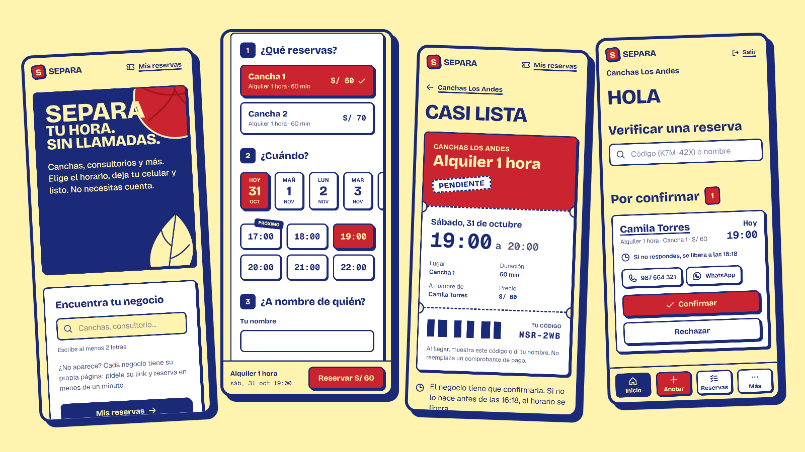
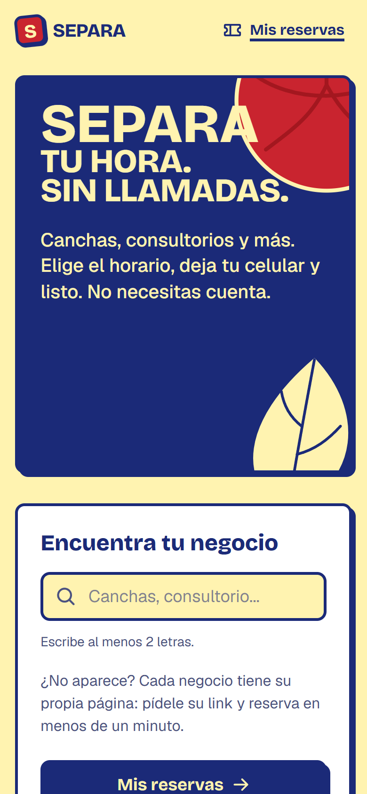
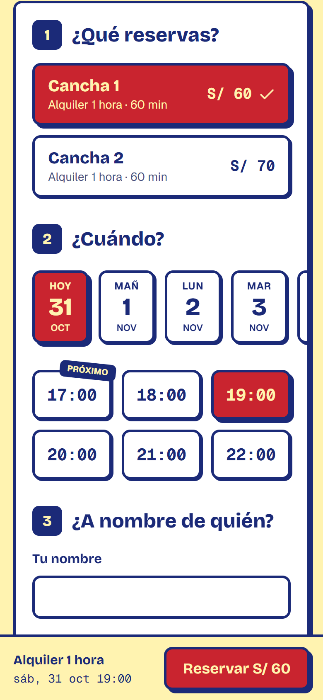
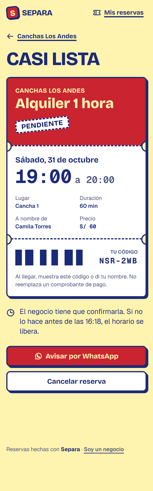
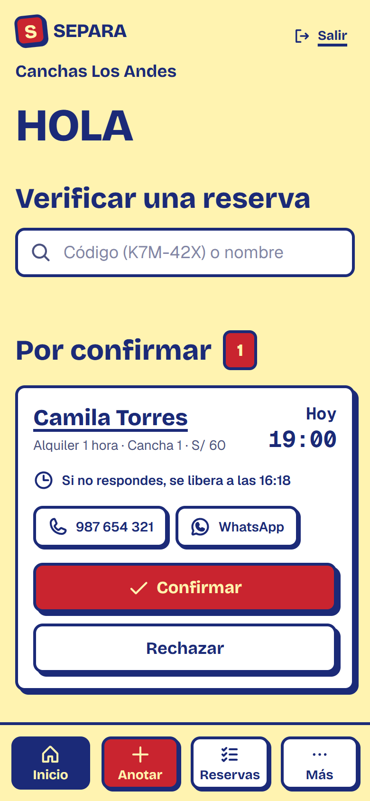
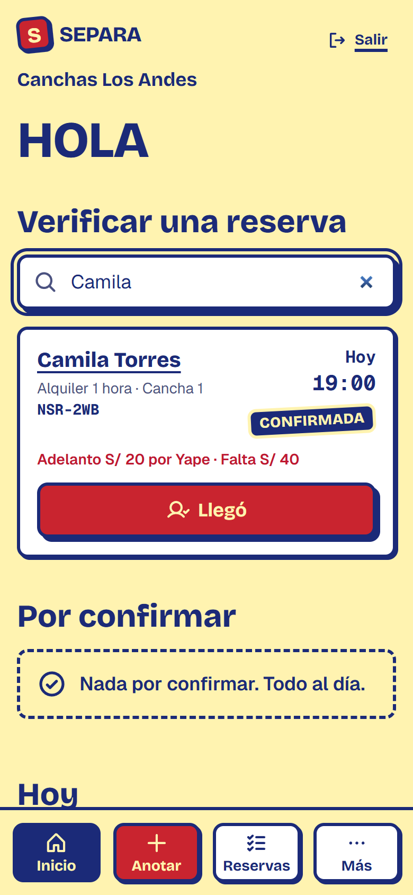
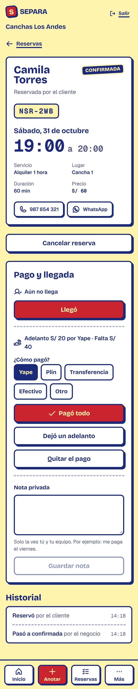
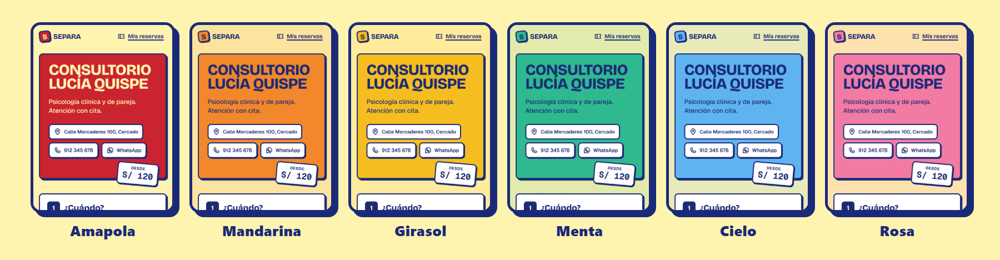
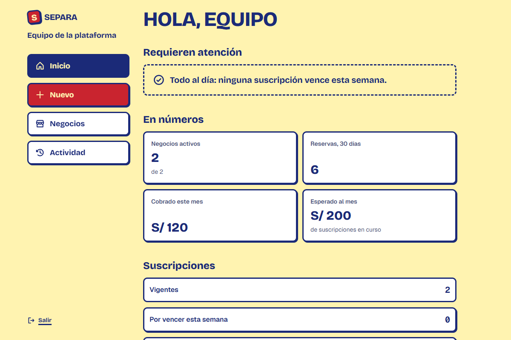

<div align="center">

# Separa

**Reservas para canchas, consultorios y negocios con citas. Sin llamadas, sin mensajes sueltos, sin cuenta para el cliente.**

*Hecho para negocios pequeños de Arequipa, Perú. Los precios son en soles y el pago ocurre entre el negocio y su cliente.*



</div>

## Qué es

Separa le da a cada negocio **su propia página de reservas**, con su enlace y su color, y un **panel** para atenderlas desde el celular. El cliente elige el horario y deja su celular; el dueño confirma con un toque. Nadie se llama para preguntar "¿está libre a las siete?", y dos personas **nunca** pueden reservar la misma hora.

No cobra reservas ni tiene pasarela de pagos: el negocio cobra como siempre (Yape, Plin, efectivo) y **anota** lo que recibió. La plataforma vive de una suscripción mensual que cobra el equipo a cada negocio.

> **Pruébalo:** <https://separa.sjbalonzo201c.workers.dev> es el entorno de prueba, en servicios gratuitos. La primera visita después de un rato puede tardar hasta un minuto en despertar.

## Para quien reserva

No necesita cuenta, instalar nada ni esperar respuesta. Entra por el enlace del negocio o lo busca en el inicio.

<table>
  <tr>
    <td align="center" width="33%"></td>
    <td align="center" width="33%"></td>
    <td align="center" width="33%"></td>
  </tr>
  <tr>
    <td align="center"><b>Encuentra el negocio</b><br>Por su nombre, o con el enlace que le dieron.</td>
    <td align="center"><b>Elige y reserva</b><br>Solo se ofrecen horarios realmente libres.</td>
    <td align="center"><b>Recibe su boleto</b><br>Con un código para mostrar en el local.</td>
  </tr>
</table>

- Los horarios se calculan contra lo ya reservado, los bloqueos y las reglas del negocio. Un horario ocupado no aparece.
- Si el negocio confirma a mano, la reserva queda **pendiente** y el horario se mantiene un tiempo limitado; si nadie responde, se libera sola.
- La segunda visita es casi instantánea: el inicio y la página de cada negocio se muestran con lo último que se vio mientras se actualizan por detrás.
- El boleto se guarda en el celular (**Mis reservas**), se puede cancelar desde ahí dentro del plazo del negocio, y la aplicación se instala como cualquier otra.
- Un correo opcional avisa cuando la reserva se confirma, se rechaza o vence.

## Para el dueño del negocio

El panel abre con lo urgente: lo que falta confirmar y lo de hoy.

<table>
  <tr>
    <td align="center" width="33%"></td>
    <td align="center" width="33%"></td>
    <td align="center" width="33%"></td>
  </tr>
  <tr>
    <td align="center"><b>Responde en un toque</b><br>Confirmar o rechazar, y llamar o escribir por WhatsApp.</td>
    <td align="center"><b>Verifica a quien llega</b><br>Por su código o su nombre, sin lector de QR.</td>
    <td align="center"><b>Anota cobro y llegada</b><br>Sin pagar, adelanto o pagada, con método y nota privada.</td>
  </tr>
</table>

- **Verificar una reserva:** el cliente muestra su código (`K7M-42X`) o dice su nombre; el dueño lo busca y marca "Llegó".
- **Cobros sin pasarela:** cada reserva registra qué se pagó, cómo y cuánto falta. La pestaña **Con saldo** lista lo pendiente. El texto de "Cómo te pagan" (por ejemplo, el número de Yape) sale en el correo y el boleto del cliente.
- **Contra las bromas:** cada reserva pendiente muestra quién es (verificado con Google, cliente conocido, primera vez, con faltas) y el botón **"Era una broma"** la descarta y bloquea al cliente. Se puede elegir confirmar solas solo las reservas de clientes de confianza, y quien falta dos veces se bloquea solo.
- **Reservas por teléfono:** se anotan en el momento y el cliente recibe su enlace.
- **Clientes, bloqueos, horarios, servicios y reglas** (anticipación, cancelación, confirmación automática o manual) se configuran desde el celular.
- **Su propio color.** Cada negocio elige el acento de su página; el azul y el amarillo de Separa se mantienen para que todo se lea bien.

<div align="center">

</div>

## Para el equipo de la plataforma

Los negocios no se registran solos: el equipo los da de alta. Esa área vive en `/plataforma`.

<div align="center">

</div>

- **Alta de un negocio** con su dueño y su suscripción de una vez. El dueño recibe un correo para elegir su contraseña, o el equipo le entrega una **contraseña temporal** (se muestra una sola vez, para enviarla por WhatsApp) y él debe cambiarla al entrar.
- **Suscripciones:** pagos registrados (Yape, Plin, transferencia, efectivo), vigencia, **5 días de gracia** y suspensión. Un negocio vencido deja de recibir reservas, pero su página sigue explicando qué pasa.
- **Soporte:** el equipo puede entrar al panel de un negocio por dos horas con un motivo, y todo lo que haga queda en un registro que no se edita.

## Lo que lo hace confiable

| | |
|---|---|
| **Sin reservas duplicadas** | La base de datos misma impide dos reservas que se solapen en un espacio, aunque lleguen al mismo tiempo. Hay pruebas de concurrencia con conexiones reales. |
| **Un negocio no ve a otro** | Cada consulta del panel se limita al negocio de quien la hace. |
| **Acceso cuidado** | Correo y contraseña, o Google (que solo deja entrar a cuentas ya creadas). Las contraseñas temporales obligan a elegir una propia, y recuperar la contraseña cierra las demás sesiones. |
| **Pensado para el celular** | Se instala como aplicación, tiene modo oscuro y se probó sin desbordes en pantallas de 390 px. |
| **Documentado** | Cada decisión y regla de negocio tiene su registro en [`docs/`](docs/). |

## Estado

El **MVP está completo**: página y reserva del cliente, panel del negocio, área del equipo, correos de aviso, buscador y lista de negocios en el inicio, y acceso con contraseña temporal. Pasan **1056 pruebas del backend** y **565 del frontend**, y el código ya está preparado para producción y probándose en internet.

Lo que sigue es poner un **dominio propio** (para enviar correos a cualquier destinatario y activar Google con comodidad), elegir el nombre definitivo del producto y pasar el servidor a un plan que no se duerma. El detalle está en el [plan de construcción](docs/08-plan-de-construccion.md).

## Tecnología

| Parte | Con qué |
|---|---|
| Servidor | Django 5 y Django REST Framework, PostgreSQL 17 |
| Aplicación | React 19, Vite, TypeScript, Tailwind CSS 4, TanStack Query |
| Acceso | JWT, Google Identity Services |
| Despliegue de prueba | Neon (base de datos), Render (servidor), Cloudflare (aplicación) |
| Desarrollo | Docker Compose |

---

## Para desarrolladores

<details>
<summary><b>Ejecutarlo en tu computadora</b></summary>

Requiere Docker Desktop.

```bash
docker compose up                                   # backend en http://localhost:8000
docker compose run --rm backend python manage.py migrate
docker compose run --rm backend pytest              # pruebas del backend
docker compose exec frontend npx vitest run         # pruebas del frontend
```

`docker compose up` levanta la base de datos, el backend y el frontend, y aplica las migraciones al arrancar. Para ver todo con datos:

```bash
docker compose run --rm backend python manage.py seed_demo
```

Crea una cancha y un consultorio de ejemplo con su dueño (`canchas@demo.pe` y `consultorio@demo.pe`) y su suscripción (la cancha vigente, el consultorio en sus días de gracia para ver los avisos), y un miembro del equipo (`equipo@demo.pe`). Todos con contraseña `demo12345`. Solo funciona en desarrollo.

| URL | Qué es |
|---|---|
| http://localhost:5173/ | Inicio, con la lista y el buscador de negocios |
| http://localhost:5173/canchas-los-andes | Página de reserva de la cancha de ejemplo |
| http://localhost:5173/consultorio-lucia | La del consultorio, con otro color |
| http://localhost:5173/mis-reservas | Boletos guardados en este dispositivo |
| http://localhost:5173/panel | Panel del negocio (`canchas@demo.pe` / `demo12345`) |
| http://localhost:5173/plataforma | Área del equipo (`equipo@demo.pe` / `demo12345`) |
| http://localhost:8000/api/docs/ | Lista interactiva de endpoints (Swagger) |
| http://localhost:8000/api/health/ | Estado de la API y la base de datos |

Si cambian las dependencias del frontend (`package.json`), recrea su contenedor con `docker compose up -d --build -V frontend`.

</details>

<details>
<summary><b>Variables de entorno (<code>.env</code>)</b></summary>

Copia `.env.example` a `.env` (Git lo ignora). Todo es opcional en desarrollo.

| Variable | Para qué |
|---|---|
| `GOOGLE_CLIENT_ID` | Activa el acceso con Google (ver abajo) |
| `EMAIL_HOST`, `EMAIL_PORT`, `EMAIL_HOST_USER`, `EMAIL_HOST_PASSWORD` | Servidor SMTP. Con `EMAIL_HOST` vacío, los correos se imprimen en la consola del backend |
| `DEFAULT_FROM_EMAIL` | Remitente de los correos |
| `FRONTEND_URL` | Dirección de la aplicación, para los enlaces dentro de los correos |
| `CONTACT_WHATSAPP`, `CONTACT_EMAIL` | A dónde escribe quien quiere su negocio en Separa: cada uno muestra su botón en el inicio y queda visible para todos. Vacíos, no aparece ninguno |

Comprueba el envío de correos sin esperar a una reserva: `docker compose run --rm backend python manage.py send_test_email tu@correo.com`. Los proveedores, puertos y límites están en [10 - Despliegue de prueba](docs/10-despliegue.md).

</details>

<details>
<summary><b>Acceso con Google</b></summary>

1. En Google Cloud Console crea un ID de cliente OAuth de tipo "Aplicación web".
2. En "Orígenes de JavaScript autorizados" agrega el de cada frontend: `http://localhost:5173` y `http://localhost` en desarrollo, y el dominio real en producción (Google puede tardar unos minutos).
3. Pon el ID en `GOOGLE_CLIENT_ID` (servidor) y, al compilar el frontend, en `VITE_GOOGLE_CLIENT_ID`. `docker compose` ya pasa el segundo.

Solo se usa el ID de cliente, que es público; el secreto no hace falta. Google solo deja entrar a usuarios que ya existen. Sin configurar, `POST /api/v1/auth/google/` responde 503 y el botón no se muestra.

</details>

<details>
<summary><b>Subirlo a internet gratis</b></summary>

La guía paso a paso, verificada contra la documentación de cada servicio, está en [10 - Despliegue de prueba](docs/10-despliegue.md): base de datos en Neon, servidor en Render con el `render.yaml` del repositorio, y la aplicación en Cloudflare.

</details>

## Documentación

| Documento | Contenido |
|---|---|
| [01 - Visión y alcance](docs/01-vision-y-alcance.md) | Qué es el producto, actores, alcance del MVP |
| [02 - Registro de decisiones](docs/02-decisiones.md) | Decisiones tomadas, su motivo y preguntas abiertas |
| [03 - Investigación de mercado](docs/03-investigacion-mercado.md) | Competidores y prácticas del sector |
| [04 - Glosario](docs/04-glosario.md) | Términos del dominio |
| [05 - Requisitos](docs/05-requisitos.md) | Requisitos funcionales y no funcionales |
| [06 - Reglas de negocio](docs/06-reglas-de-negocio.md) | Disponibilidad, reserva, cancelación, cobros, suscripción y acceso |
| [07 - Arquitectura](docs/07-arquitectura.md) | Stack, multi-tenancy, modelo de datos y API |
| [08 - Plan de construcción](docs/08-plan-de-construccion.md) | Hitos, dependencias y riesgos |
| [09 - Diseño del frontend](docs/09-diseno-frontend.md) | Dirección visual, paleta, pantallas y reglas de contenido |
| [10 - Despliegue de prueba](docs/10-despliegue.md) | Cómo montarlo gratis y qué probar |

## Principios

1. **Flexible por configuración:** lo que varía entre negocios (duración de bloques, cancelación, confirmación) se configura, no se programa.
2. **Simple primero:** el MVP prueba que las reservas funcionan.
3. **Convención de idioma:** documentación en español; código, rutas de la API y commits en inglés.
4. **Preparado para crecer:** el modelo de datos admite recurrencia, varios espacios y varios usuarios aunque su interfaz llegue después.
